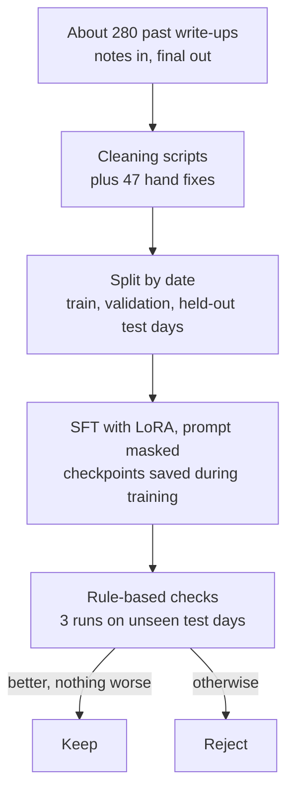

# Fine-tuned evaluation drafting model

A LoRA fine-tune that turns my shorthand dictated notes into a finished, structured evaluation write-up in my house style. Training and inference run entirely on my own Mac.

## Goal

After each evaluation I dictate quick shorthand notes. The goal was a model that turns those notes into the write-up I would submit, in my house style and exact format, without anything leaving my machine. Before this, a local model needed an instruction prompt of about 10,300 tokens to do the job.

## Setup

- **Base model:** Gemma 4 12B, instruction-tuned, 4-bit
- **Framework:** Apple MLX with mlx-lm
- **Hardware:** M1 Max with 32 GB of memory, about 12 seconds per training step
- **Privacy:** training and inference both run locally. Nothing goes to a cloud service.

## Data

- About 280 of my own past evaluation write-ups. Input: my dictated notes, exactly as given. Target: the final write-up I submitted.
- Cleaned with scripts, no model in the loop. Older write-ups opened in about five different ways, so a script rewrote openings to the current form. I rewrote the 47 it couldn't handle by hand.
- About 1,000 tokens per example.
- Split by date:
  - 225 training tasks
  - 24 validation tasks, never trained on
  - Held-out test days, never trained on: 15 tasks in round 1, 27 in round 2
- A script can score any new day of work as fresh test tasks, and each retrain moves the newest days into the test set, so the test is always work the model has never seen.

## How I evaluate

Rule-based requirement checks against my final write-up, not similarity metrics. A draft passes a check only if it gets that part right.

| Check | What it requires |
|---|---|
| Preference | Prefers the same response I did |
| Deciding dimension | Names the same quality I named as the deciding one |
| Audio | Lists every timestamped audio issue I noted, with the right turn and type |
| Relative call | Calls the same response cleaner and the other worse (on tasks where I made that call) |
| Quotes | Keeps each quoted phrase from my final, with at least 60% word overlap |
| Format | Matches the exact output structure my workflow expects |

- 3 runs per version. Sampling at temperature 0.3 means the same version can differ by a task or two between runs.
- One change at a time. A change is kept only if it helps on the test tasks and nothing else gets worse.

## Training: supervised fine-tuning

- LoRA at rank 16 on the last 16 layers: 21.9M trainable parameters, 0.18% of the model.
- Prompt masked, so the loss counts only the write-up, not the instructions or my notes.
- Validation loss went from 1.98 before training to 0.624 after one pass. It rose to 0.696 early in the second pass, a sign of memorizing, so I stopped early and kept the best checkpoint.
- A short finishing pass on the 56 newest tasks scored slightly worse on the test tasks, so I didn't keep it.

## The DPO experiment, and why I rejected it

After SFT I tried preference tuning (DPO, then the DPOP variant) on 234 pairs, each my final write-up against another draft of the same task.

The DPO training tool (mlx-lm-lora 5.8.6) had two bugs that I worked around with a wrapper script:

1. The loss type set in the config never reached the training step, so runs meant to use DPOP trained as plain DPO.
2. The loss scored the whole conversation, prompt and notes included, instead of only the response.

The training metrics looked healthy throughout. On held-back pairs, loss went from 0.162 to 0.148 and the reward margin grew from 2.52 to 3.22. The test tasks told a different story:

- **Format broke on all 27 test tasks.** The model kept writing its end-of-turn marker as text instead of stopping. The likely cause is the tool adding the marker as text rather than as a special token, but I didn't confirm it.
- **Quality dropped too.** With that junk stripped out, it got the deciding dimension right on 17 of 27, against 23 of 27 for the SFT model it started from. Quotes and audio also slipped.

I rejected it. **The final model does not use DPO. It is SFT only.**

## Round 2

- Two input changes, also used in my app: a fix to the script that reads my audio shorthand, and a script-built list of the quotes I dictated, added to the model's input.
- Retrained SFT from the base model and scored checkpoints every 75 steps.
- Validation loss preferred step 225 (0.626 against 0.702 at step 300). The test tasks preferred step 300: over 3 runs each, it kept more quotes (74 against 68 of 90) and got the deciding dimension right more often (68 against 65 of 81), with every other check level. I kept step 300.
- One added line in the short prompt then raised the deciding dimension from 68 to 77 of 81.

## Results

Final model: round 2, step 300, with the added prompt line. 27 held-out test tasks, 3 runs. The baseline is the base model with the full 10,300-token prompt, 2 runs.

| Check | Fine-tuned, short prompt | Base model, full prompt |
|---|---|---|
| Format | 81/81 (100%) | 50/54 (93%) |
| Audio | 79/81 (98%) | 50/54 (93%) |
| Preference | 78/81 (96%) | 52/54 (96%) |
| Deciding dimension | 77/81 (95%) | 45/54 (83%) |
| Relative call | 45/48 (94%) | 28/32 (88%) |
| Quotes | 71/90 (79%) | 55/60 (92%) |

Quotes were the one check where the fine-tuned model trailed. So I added a quote check to my app, plain code with no model: it looks for every quote I dictated in the draft, and if one is missing, it asks the model once more and keeps the second try only if it holds more of the quotes and keeps the format. Through the app, this raised quotes from 45 to 52 of 60 (2 runs), with the other checks level.

## Outcome

- The instruction prompt went from about 10,300 tokens to a few hundred.
- It was the default model for my standard evaluations from October 7, 2026 until October 22, when I switched the local model off in my workflow.

## What I took from it

- Define what a correct output must contain, then check for exactly that.
- Test on unseen cases, held out by date.
- Don't trust healthy training metrics alone. The DPO run improved on every training number and failed the test, and in round 2 validation loss picked the weaker checkpoint.
- Run every version more than once. One run can be off by a task or two.

## How I built this

The scripts are Python, plus a few shell scripts for overnight runs, written with Claude Code under my direction. They cover data extraction and cleaning, building the splits, training configs, test runs, and scoring. I defined the requirements, the data setup, and the evaluation method, reviewed and tested the code, and made edits.

**Stack:** Python, Apple MLX, mlx-lm, LoRA, Gemma 4 12B. mlx-lm-lora for the rejected DPO experiment only.

---

Source is private. Happy to walk through it in a live demo: ptrgaffney@gmail.com.
